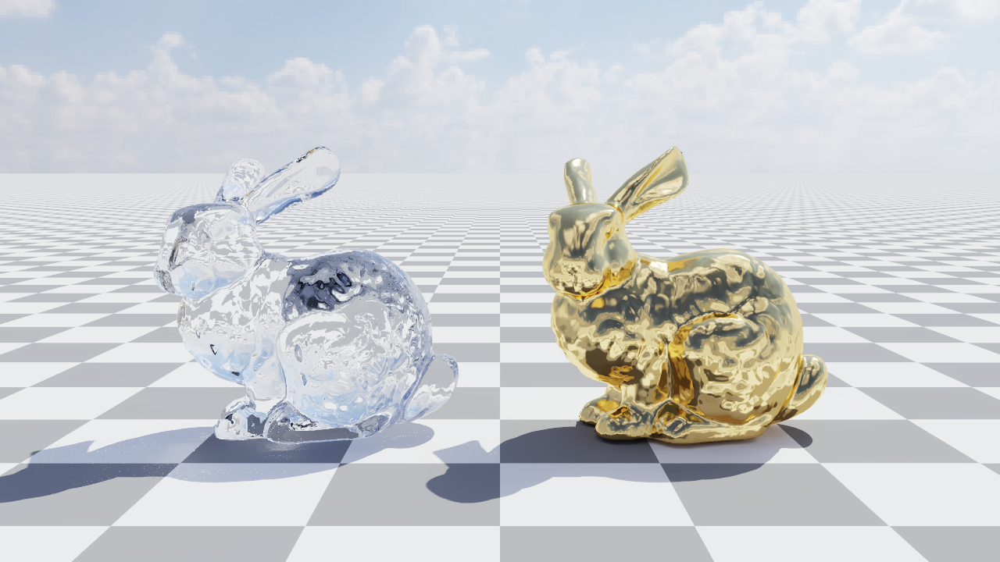
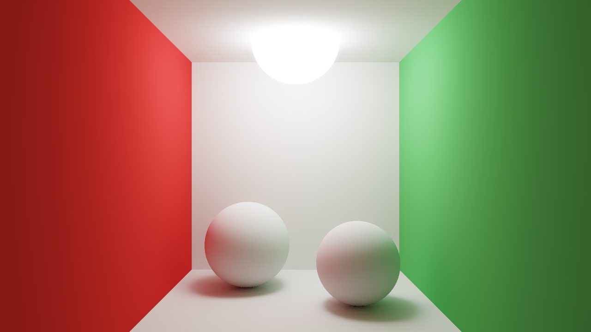
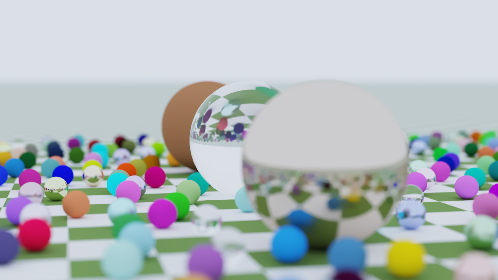
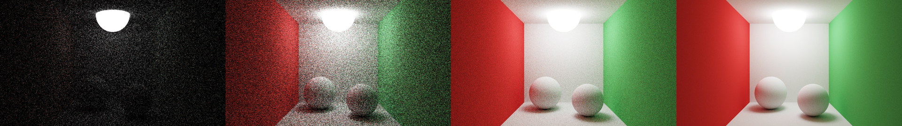
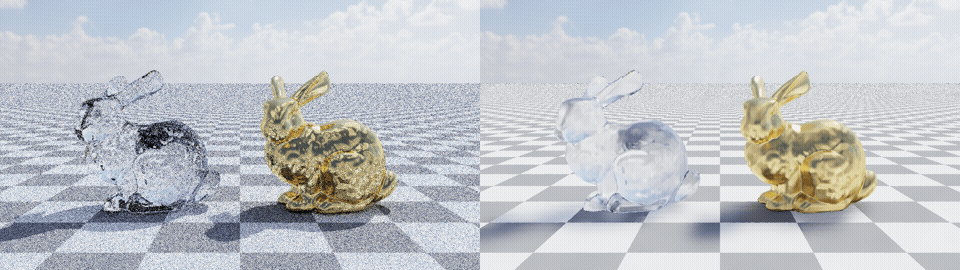

# CUDA Path Tracer

A from-scratch GPU path tracer in C++17 and CUDA. It renders spheres, planes and triangle meshes (BVH-accelerated) with diffuse, metal, glass and emissive materials, depth of field and HDRI environment lighting. You can fly through the scene live in an OpenGL window, and two convolution filters clean the image: an edge-aware à-trous denoiser and bloom.



| Cornell box (4096 spp) | Random spheres, depth of field (2048 spp) |
|---|---|
|  |  |

Noise at 1, 16, 256 and 4096 samples per pixel (denoiser off):



The image refining over 1 to 256 samples, denoiser off (left) and on (right):



## Features

- One CUDA thread per pixel, an iterative bounce loop and progressive accumulation (one sample per kernel launch).
- Materials: diffuse (Lambert), metal with fuzz, glass (Snell refraction, total internal reflection, Schlick Fresnel) and emissive.
- Thin-lens camera with aperture and focus distance.
- Triangle meshes from OBJ files. The BVH is built on the CPU, flattened, and traversed on the GPU with an explicit stack.
- HDRI sky with importance sampling, plus next-event estimation and multiple importance sampling at diffuse hits.
- Russian roulette path termination.
- Debug views from the first hit: normals, albedo and depth.
- À-trous denoiser (5 passes) guided by normal, albedo and depth, plus a color term scaled by each pixel's own noise level.
- Bloom: a firefly-resistant bright pass, then a separable Gaussian blur.
- Exposure, ACES tonemapping and gamma correction.
- Live viewer: CUDA writes straight into an OpenGL pixel buffer (no CPU copy), with a fly camera and a Dear ImGui panel for every setting.

## Requirements

- Windows 10/11 with an NVIDIA GPU (any architecture CUDA 13 supports). The GPU must also be able to drive an OpenGL window. On hybrid-graphics laptops, avoid any "iGPU only" / Eco GPU mode.
- [CUDA Toolkit](https://developer.nvidia.com/cuda-downloads) 13.x, and an NVIDIA driver that supports it.
- Visual Studio 2022 or its Build Tools, with the "Desktop development with C++" workload.
- [CMake](https://cmake.org/download/) 3.24 or newer.
- Git, and internet access on the first configure (CMake downloads GLFW and Dear ImGui).

With winget, the toolchain is:

```
winget install Microsoft.VisualStudio.2022.BuildTools --override "--quiet --wait --add Microsoft.VisualStudio.Workload.VCTools --includeRecommended"
winget install Nvidia.CUDA
winget install Kitware.CMake
```

Install Visual Studio before CUDA, so CUDA can add its Visual Studio integration. Open a new terminal afterwards so `CUDA_PATH` is set.

## Build

```
git clone https://github.com/RohitKarthickeyan/path-tracing.git
cd path-tracing
cmake -S . -B build
cmake --build build --config Release
```

CMake compiles for the GPU in your machine (`CMAKE_CUDA_ARCHITECTURES=native`). To target a specific GPU instead, pass e.g. `-DCMAKE_CUDA_ARCHITECTURES=89`.

## Run

Run from the repository root, because scenes load files from `assets/`.

Live viewer:

```
build\Release\pt --scene bunny
```

Render a still to PNG:

```
build\Release\pt --scene cornell --spp 1024 --out cornell.png
```

| flag | meaning | default |
|---|---|---|
| `--scene` | `sphere`, `furnace`, `cornell`, `spheres`, `bunny` | `sphere` |
| `--spp N` | samples per pixel (stills only) | 64 |
| `--exposure X` | exposure multiplier | 1 |
| `--denoise 0\|1` | à-trous denoiser | 1 |
| `--bloom 0\|1` | bloom | 1 |
| `--out file.png` | write a 1280x720 still instead of opening the viewer | none |

## Viewer controls

| input | action |
|---|---|
| right mouse drag | look around |
| W A S D | move forward, left, back, right |
| Q / E | move down / up |
| Shift | move faster |
| 1 2 3 4 | view color, normals, albedo, depth |
| N | toggle denoiser |
| B | toggle bloom |
| Esc | quit |

The window opens at 1600x900 and is resizable (larger windows render more pixels, so fps drops). The panel exposes the scene and HDRI, samples per frame, max bounces, environment intensity and rotation, field of view, aperture, focus distance, exposure, ACES, view mode, all denoiser sigmas and iterations, and the bloom threshold, knee, strength and radius. Changes that affect sampling restart the accumulation.

## Scenes

- `furnace`: a diffuse sphere (albedo 0.8) in a uniform white sky. It must render exactly 0.8, which is a correctness check.
- `cornell`: Cornell box with a spherical lamp, showing red and green color bleeding.
- `spheres`: about 470 random diffuse, metal and glass spheres on a checkerboard, with depth of field.
- `bunny`: glass and gold Stanford bunnies (139k triangles) on a checkerboard under an HDRI sky.
- `sphere`: a single sphere on a plane.

## Pipeline

Every displayed frame runs this chain on the GPU. Color stays in linear floating point until the final stage.

```
scene (spheres, planes, BVH triangles, materials, HDRI + its CDFs)
  │
  ▼
path_kernel ×N   one thread per pixel, one sample per launch
  │              accum += color (and luminance² in .w), AOVs += normal/depth, albedo
  ▼
mean_kernel      accum / spp, plus each pixel's noise std in .w
  ▼
denoise          5 à-trous passes, taps spaced 1, 2, 4, 8, 16 px (ping-pong buffers)
  ▼
bloom            bright pass → horizontal Gaussian → vertical Gaussian
  ▼
resolve_kernel   + bloom × strength → exposure → ACES → gamma 2.2 → RGBA8
  ▼
OpenGL pixel buffer (viewer, mapped into CUDA, no CPU copy)  or  PNG (CLI)
```

Accumulation restarts whenever the camera, the scene or a sampling setting changes. The denoiser, bloom and tonemapping run on the accumulated mean every frame, so toggling them is instant.
